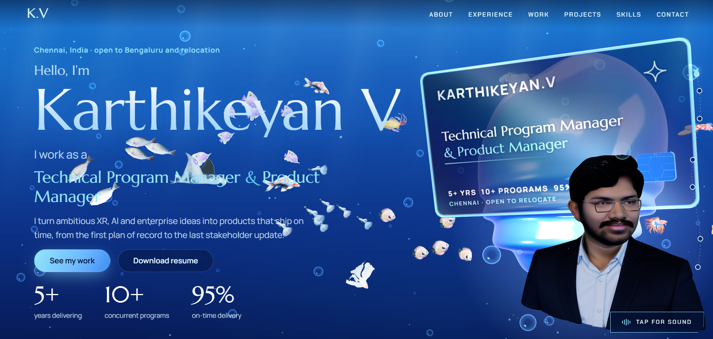
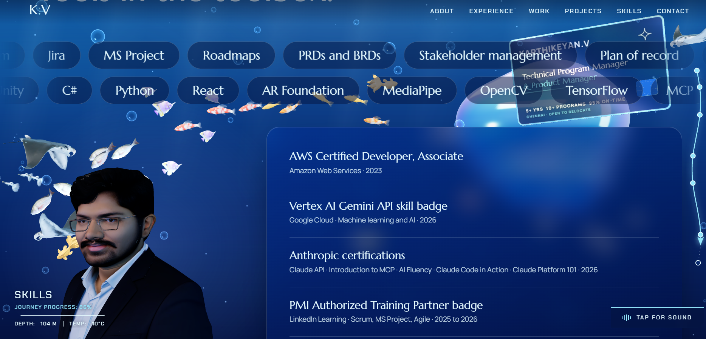

# Karthikeyan V - 3D Portfolio Website

An immersive, scroll-driven 3D portfolio set under the sea. Visitors dive from the surface to the sea floor while a chrome-glass 3D business card, a spinning 3D bust of Karthikeyan's face and a school of swimming fish move around the page.

**Created by Karthikeyan V** - Technical Program Manager and Product Manager.

**Live site:** https://karthikeyanv.netlify.app

## Preview



*Hero: intro, headline, key numbers and the 3D card.*



*Skills and certifications, with the journey HUD (progress, depth, temperature) and fish swimming past.*

## About this project

This is the personal portfolio of Karthikeyan V, a Technical Program Manager and Product Manager with 5+ years delivering XR, AI/LLM and enterprise programs across healthcare, defence, automotive and education.

Instead of a flat page, the portfolio is a dive. Scrolling moves a camera down through the water, and each section (About, Experience, Work, Projects, Skills, Contact) is a stop on the way. A small HUD shows journey progress, depth in metres and water temperature, and a wavy roadmap line with a node per stop runs down the page.

## Features

- Scroll-driven 3D scene built with Three.js, with GSAP ScrollTrigger moving the card, the face bust and the fish between sections
- Chrome-glass 3D card model with a custom canvas-drawn front and back (name, role, key numbers, rotating designations)
- Spinning 3D face bust that settles into place after an intro animation
- Swimming fish (koi, betta, guppy, manta and more) with procedural tail wag or their own animation clips
- Journey HUD (progress, depth, temperature) and a wavy SVG roadmap
- Procedural underwater sound made with the Web Audio API, no audio files, off until the visitor taps "Tap for sound"
- Smooth scrolling with Lenis
- Sections for About, Experience, Work, Projects, Skills and certifications, and Contact, plus a downloadable resume (PDF)
- Resilient and accessible: skip link, respects reduced-motion settings, falls back gracefully if WebGL is unavailable
- Fast static hosting: self-hosted fonts, minified esbuild bundle, long-term caching and security headers in `netlify.toml`

## Tech stack

| Area | Tools |
|---|---|
| 3D | Three.js (GLTFLoader, SkeletonUtils) |
| Animation | GSAP and ScrollTrigger |
| Smooth scroll | Lenis |
| Sound | Web Audio API (synthesised) |
| Build | esbuild (`build.mjs`) |
| Asset tooling | glTF-Transform CLI, sharp |
| Fonts | Chakra Petch, Manrope, Marcellus (Fontsource, self-hosted) |
| Hosting | Netlify (`netlify.toml`) |

## Project structure

```
.
|-- index.html            page content and sections
|-- build.mjs             esbuild bundle, then copies public/ into dist/
|-- netlify.toml          build settings, cache and security headers
|-- public/
|   |-- assets/           card.glb, face.glb, fish/*.glb, credits/
|   |-- fonts/            self-hosted woff2 fonts
|   |-- Karthikeyan_V_Resume.pdf
|   |-- og-image.jpg
|   `-- favicon.svg
`-- src/
    |-- main.js           scroll timeline, GSAP, Lenis, HUD
    |-- scene.js          Three.js scene, card, face bust, lighting
    |-- fishes.js         fish loading and swimming
    |-- cardTexture.js    canvas textures for the 3D card
    |-- roadmap.js        wavy SVG journey roadmap
    |-- audio.js          procedural sound
    `-- styles.css        design tokens and layout
```

## Run locally

Requires Node.js 20 or newer.

```bash
npm install
npm run dev      # builds, then serves dist/ at http://localhost:8080
npm run build    # production build into dist/
```

## Deploy to Netlify

1. **Git deploy:** push to GitHub, then "Add new site > Import from Git". `netlify.toml` already sets the build command `npm run build` and the publish directory `dist`.
2. **CLI:** `npm i && npm run build && npx netlify deploy --prod --dir=dist`
3. **Drag and drop:** run `npm run build`, then drag the `dist` folder onto https://app.netlify.com/drop

## Customise

- Copy and sections: `index.html`
- Colours and spacing tokens: top of `src/styles.css`
- Where the face and card sit in each section: `WIDE` and `NARROW` arrays in `src/main.js`
- Card text and rotating designations: `src/cardTexture.js`
- Sounds: `src/audio.js` (all synthesised)

> **Note:** the discus fish model (`fish_2.glb`) is not included because its Sketchfab Standard licence does not allow redistribution. The site runs fine without it. To restore it, add your own model at `public/assets/fish/fish_2.glb`.

## Author

**Karthikeyan V** - Technical Program Manager and Product Manager (XR, AI/LLM, enterprise delivery), Chennai, India.

- Portfolio: https://karthikeyanv.netlify.app
- LinkedIn: https://www.linkedin.com/in/karthikeyan-v-8a203a195
- GitHub: https://github.com/karthikeyan12345678